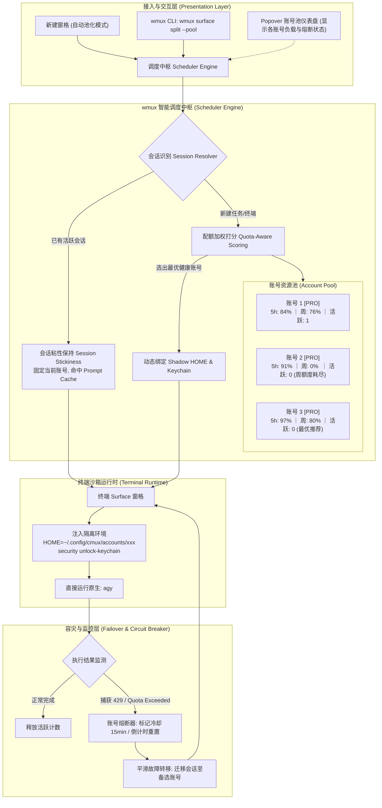
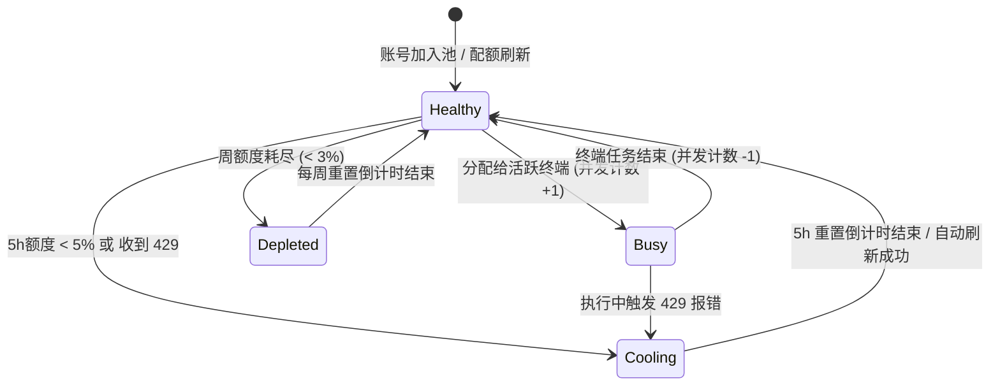

# Gemini 多账号资源池负载均衡与智能会话调度方案 (Gemini Account Pool & Load Balancing Specification)

- **状态**: Draft / Proposed
- **涉及模块**: `CmuxGeminiQuota`、`wmux Terminal Surface Runtime`、`GeminiTerminalAccountCoordinator`
- **兼容组件**: 原生 `agy` CLI、Google Antigravity 2.0 / CodeAssist 后端

---

## 一、 背景与设计目标

### 1.1 现状与痛点
在 `wmux` 当前的实现中，已经具备了非常优秀的多账号物理隔离底座：
- **Shadow HOME + 独立 Keychain**：每个 Google 账号分配一个沙箱目录（`~/.config/cmux/accounts/<account_hash>`），内部拥有专用的 `account.keychain-db`，通过 `/usr/bin/security` 解锁并管理凭据。
- **Per-Surface 静态绑定**：通过 `GeminiTerminalAccountCoordinator`，用户可以把一个指定的账号绑定到某个终端窗格（Surface UUID）。在该窗格中敲 `agy` 时，读取的就是该账号的身份。

**面临的瓶颈**：
1. **人工分配繁琐**：用户有 3~5 个甚至更多账号，必须手动记忆哪个账号额度多、哪个账号耗尽了，并在 UI 上逐个窗格指定。
2. **缺乏高可用容灾（Failover）**：当某个账号在长时间重构中将 5 小时额度或每周配额耗尽（触发 `429 / RESOURCE_EXHAUSTED`）时，当前窗格直接卡住，用户必须打断思路去手动换号。
3. **多任务吞吐量无法自动最优化**：同时开多个终端进行不同的开发任务时，无法自动利用闲置账号分摊流量。

### 1.2 设计目标
打造类似 **Magpie**（统一网关与故障转移）的多账号池化能力，但保持 **wmux 原生客户端零侵入**：
1. **零习惯改变**：用户在任何终端中依然直接敲 `agy`，不需要记任何代理命令或新 CLI 参数。
2. **多任务自动负载均衡（横向扩展）**：新开启的任务/终端自动调度到当前配额最充裕、负载最低的账号上。
3. **会话粘性保障（Session Stickiness）**：同一个对话会话全程锁定单账号，充分享受 Google 服务端 **Prompt Caching（上下文缓存）** 带来的高速与低 Token 消耗。
4. **额度见底智能熔断与无缝接力（纵向容灾）**：当前账号额度耗尽时，自动熔断冷却，并无缝切到备选账号继续执行。

---

## 二、 架构决策与选型对比

### 2.1 方案选型：终端沙箱调度 vs HTTP 代理网关

| 维度 | 方案 A：网络层 HTTP 代理网关 (Magpie 模式) | 方案 B：终端/进程级沙箱调度 (wmux Native 模式) ⭐️ |
| :--- | :--- | :--- |
| **实现机制** | 本地启动 HTTP 代理（127.0.0.1:PORT），拦截 API 请求并在后端做 Token 轮询转发。 | 利用 wmux 已有的 Shadow HOME + Keychain，在终端/进程创建层做智能调度与环境注入。 |
| **CLI 兼容性** | 差。官方 `agy` 底层走私有 gRPC/HTTP2 及 CodeAssist 专有校验，强行代理极易出错断流。 | **完美原生**。完全运行官方 `agy` 二进制，100% 兼容工具调用、本地脑图存储与 REPL 交互。 |
| **操作成本** | 需配置环境变量代理（`HTTP_PROXY`、自定义 BASE_URL 等）。 | **零配置**。终端内直接敲 `agy` 即可。 |
| **风控风险** | 较高。同一代理进程短时间内带着不同账号的高频集中请求，容易触发服务端异常风控。 | **极低**。各账号运行在独立的 macOS 钥匙串沙箱中，行为完全等同于真实多终端操作。 |
| **实施复杂度** | 高（需持续逆向和维护协议代理层）。 | **低到中**（直接复用当前 `CmuxGeminiQuota` 已完成的 70% 底层工程）。 |

**结论**：选择 **方案 B（wmux 原生终端沙箱调度池）** 为第一演进路线。

---

## 三、 系统架构与模块设计



---

## 四、 核心调度策略与算法设计

### 4.1 核心原则：会话粘性优先（Session Stickiness）

> [!IMPORTANT]
> **绝对不可在同一会话中“一问一答”轮询换号！**
> Gemini / Claude 等模型具有强大的 **服务端 Prompt Caching（前缀上下文缓存）**。
> 同一会话保持单账号可享受：
> 1. **首字延迟降低 80%**（直接命中 Google 服务端高速缓存）；
> 2. **大幅节省 Token 配额**（无需每轮重新上传几十万字符的代码库上下文）；
> 3. **避免安全风控**（避免同一 IP 在极短时间内以不同账号交替发起相同上下文请求）。

**调度决策矩阵**：
- **开启全新窗格 / 全新独立任务** $\to$ 触发**横向负载均衡**（选择当前池中健康分最高的账号）。
- **同一个窗格的多轮交互** $\to$ **锁定当前账号**，保持会话粘性。
- **当前账号额度耗尽（<5% 或 429）** $\to$ 触发**纵向容灾接力**，平滑切换到备选账号。

---

### 4.2 账号池健康度评分算法 (Quota-Aware Scoring)

当需要为新会话分配账号时，调度器根据以下公式对资源池中的每个可用账号打分：

$$Score(A) = (Quota_{5h} \times 0.6) + (Quota_{weekly} \times 0.3) - (InflightTasks \times 20) - Penalty$$

各参数定义与权重说明：
1. **$Quota_{5h}$ (权重 0.6)**：5 小时滑动窗口的剩余配额百分比（0~100）。短期高频开发的核心瓶颈，权重最高。
2. **$Quota_{weekly}$ (权重 0.3)**：每周配额剩余百分比（0~100）。若每周配额 $\le 5\%$，该账号直接不可选（进入周冷却）。
3. **$InflightTasks$ (并发惩罚项)**：当前正绑定到该账号且正在执行任务的终端数量。每增加 1 个活跃会话扣 20 分，防止将多个重型任务堆叠到同一账号引发单账号并发限速。
4. **$Penalty$ (惩罚项)**：
   - 处于冷却状态（刚遇到 429 或 5h 额度 $\le 3\%$）：$Penalty = \infty$（直接剔除候选池）。
   - 普通账号：$Penalty = 0$。

---

### 4.3 熔断与恢复状态机 (Circuit Breaker)

每个账号在池中具备以下 4 种状态：



1. **自动冷却（Cooling）**：
   - 触发条件：终端捕获到 `RESOURCE_EXHAUSTED` / `429`，或配额刷新发现 5h 桶剩余 $< 5\%$。
   - 行为：15 分钟内不再分配新会话；UI 状态标黄并显示「冷却中（等待重置）」。
2. **自动恢复（Self-Healing）**：
   - `CmuxGeminiQuota` 既有的后台定时轮询（默认 5~15 分钟）会拉取 `retrieveUserQuotaSummary`。
   - 当重置倒计时到达或配额回血超过 $20\%$，自动将状态回拨为 `Healthy`。

---

## 五、 代码落地与演进蓝图

### 5.1 数据模型扩展 (`CmuxGeminiQuota`)

在 `Packages/macOS/CmuxGeminiQuota/Sources/CmuxGeminiQuota/` 中增加调度器核心逻辑：

```swift
// Isolation/GeminiAccountPoolScheduler.swift

@MainActor
@Observable
public final class GeminiAccountPoolScheduler {
    public private(set) var accountStore: GeminiAccountStore
    public private(set) var coolingAccounts: [String: Date] = [:] // accountID -> 冷却到期时间
    public private(set) var activeSessionCounts: [String: Int] = [:] // accountID -> 活跃终端数

    public init(accountStore: GeminiAccountStore) {
        self.accountStore = accountStore
    }

    /// 根据评分算法挑选最健康的账号
    public func pickOptimalAccount() -> GeminiAccount? {
        let now = Date()
        let availableAccounts = accountStore.accounts.filter { account in
            if let coolUntil = coolingAccounts[account.id], coolUntil > now {
                return false
            }
            // 过滤周额度见底的账号
            if let weekly = account.weeklyQuota, weekly <= 0.05 {
                return false
            }
            return true
        }

        return availableAccounts.max { a, b in
            score(for: a) < score(for: b)
        }
    }

    private func score(for account: GeminiAccount) -> Double {
        let quota5h = (account.fiveHourQuota ?? 0.0) * 100.0
        let quotaWeekly = (account.weeklyQuota ?? 0.0) * 100.0
        let active = Double(activeSessionCounts[account.id] ?? 0)

        return (quota5h * 0.6) + (quotaWeekly * 0.3) - (active * 20.0)
    }

    public func markCooling(accountID: String, duration: TimeInterval = 900) {
        coolingAccounts[accountID] = Date().addingTimeInterval(duration)
    }
}
```

### 5.2 终端协调器升级 (`GeminiTerminalAccountCoordinator`)

升级已有的 `GeminiTerminalAccountCoordinator.swift`：
```swift
// 新增自动调度接口
public func bindAuto(surfaceID: UUID) -> GeminiAccount? {
    // 1. 如果当前 surface 已经绑定了可用账号，保持粘性
    if let existing = effectiveAccount(for: surfaceID), isHealthy(existing) {
        return existing
    }

    // 2. 否则从池中获取最优可用账号
    guard let optimal = scheduler.pickOptimalAccount() else {
        return accountStore.defaultAccount
    }

    // 3. 执行原有的 Shadow HOME 和 Keychain Provision 逻辑
    bind(surfaceID: surfaceID, to: optimal.id)
    scheduler.incrementActive(for: optimal.id)
    return optimal
}

// 终端关闭时释放计数
public func release(surfaceID: UUID) {
    if let accountID = surfaceBindings[surfaceID] {
        scheduler.decrementActive(for: accountID)
    }
    unbind(surfaceID: surfaceID)
}
```

### 5.3 UI 增强 (`GeminiQuotaPopoverView.swift`)

在侧边栏配额卡片顶部增加：
- **模式切换开关**：`[ 单账号固定 ｜ 智能池化自动调度 (Auto Pool) ]`
- **池状态汇总胶囊**：显示 `池内可用: 3/4 账号 ｜ 总算力充沛`
- **快速操作**：一键「新建池化终端窗格」

---

## 六、 边界情况与安全防护

1. **Keychain 并发争用保护**：
   - 现有的 `provisionKeychain` 会通过 `/usr/bin/security` 创建并解锁钥匙串。
   - 当多个终端窗格同时并发拉起时，需要引入 `NSLock` 或串行队列确保钥匙串写操作互斥，避免 `security add-generic-password` 写入争用。
2. **本地 Session 文件与上下文保护**：
   - 由于已经将 `REAL_USER_HOME` 指回用户宿主主目录，项目的 git 配置与项目内 `.gemini` 缓存仍然共享，账号切换不会导致本地仓库历史丢失。
3. **Google 账号同 IP 并发风控**：
   - 建议单个用户管理的账号数量保持在 3~8 个。
   - 借助会话粘性机制，同一个会话不会频繁跳号，从行为模式上完全等同于一名资深工程师在多终端上并行处理不同项目。

---

## 七、 实施阶段计划

- [ ] **Phase 1: 核心调度器原型**
  - 实现 `GeminiAccountPoolScheduler`，支持加权健康度打分与会话计数；
  - 增加单元测试，验证配额排序与临界剔除逻辑。
- [ ] **Phase 2: 终端生命周期与自动绑定**
  - 在新建 Surface 时默认接入 `bindAuto(surfaceID:)`；
  - 监听 Surface 关闭事件，释放活跃账号计数。
- [ ] **Phase 3: 输出异常监测与容灾切换 (Failover)**
  - 监听终端输出流，当捕获到 `RESOURCE_EXHAUSTED` 时发出通知并触发一键/自动无缝换号重试。
- [ ] **Phase 4: UI 仪表盘与可视化**
  - 丰富 `GeminiQuotaPopoverView`，展示账号池整体健康度与调度历史。
