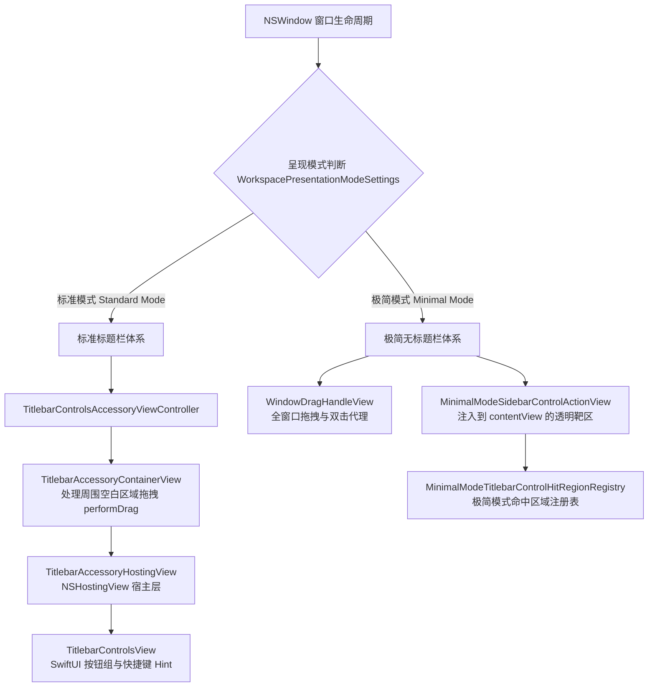

# 侧边栏与标题栏交互架构及全景排查指南 (Sidebar & Titlebar Architecture and Diagnostics)

本文档记录 cmux / wmux 中**左侧边栏（Left Sidebar）与窗口标题栏（Window Titlebar）控制区**的交互设计、底层 AppKit/SwiftUI 桥接机制、事件路由状态机，以及第一次 Commit 至今的根本缺陷定位与终极修复方案。后续关于侧边栏点击异常、无法收起/展开、布局尺寸竞争等问题，均可以此文档作为基准拓扑开展排查。

---

## 一、 架构全景与模式分离 (Architectural Overview)

侧边栏的交互与窗口呈现模式紧密耦合。系统存在两种根本性的呈现模式（`WorkspacePresentationModeSettings`）：



### 1. 标准模式 (Standard Mode)
- **外观**：保留 macOS 原生窗口标题栏高度（约 28-32pt），红绿灯交通灯位于左侧。
- **承载载体**：由 `UpdateTitlebarAccessoryController` 向窗口添加 `NSTitlebarAccessoryViewController`（即 `TitlebarControlsAccessoryViewController`）。
- **层级关系**：
  1. `NSTitlebarView` (AppKit 原生标题栏视图)
  2. `TitlebarAccessoryContainerView` (外层容器，尺寸紧凑包裹控件组，处理左侧红绿灯间隙与留白拖拽)
  3. `TitlebarAccessoryHostingView` (SwiftUI 宿主层，专门承载 5 个功能按钮，隔离拖拽)
  4. `TitlebarControlsView` (包含 `TitlebarControlButton(toggleSidebar)`、通知、新建标签页、后退/前进按钮)

### 2. 极简模式 (Minimal Mode / Zen)
- **外观**：去除原生标题栏，终端/分屏内容直顶窗口上边缘；侧边栏收起时红绿灯缩入标签栏左侧保留区（80pt inset）。
- **承载载体**：原生标题栏 Accessory 尺寸置为零并隐藏（`showsWorkspaceTitlebar == false`）。由 `WindowDecorationsController` 在窗口 `contentView` 顶层动态挂载透明交互靶区 `MinimalModeSidebarControlActionView`。
- **触发机制**：常态下透明隐藏，当鼠标悬停在左上角特定几何区域（`isMinimalModeSidebarChromeHoverCandidate`）或通知 Popover 弹出时，通过 `MinimalModeSidebarChromeHoverState` 浮现激活。

---

## 二、 第一次 Commit (`33dd4f2e`) 与现行代码的根因对比分析

用户核心诉求：**“分析第一次commit的内容跟现在的代码，看看为啥左上角的侧边栏按钮点击异常，侧边栏无法正常收缩。排除所有缓存外的因素。”**

### 1. 缓存与环境误判的本质
- **为什么在 Dev 曾“看起来好了”，打包 DMG Release 或 Clean Dev 依然复现？**
  1. **Bundle ID 与 UserDefaults 隔离**：
     - 本地开发调试（`reload.sh --tag dev`）使用的 Bundle ID 是 `com.cmuxterm.app.debug.dev`。
     - 打包 DMG Release 构建（`build-dmg.sh`）使用的 Bundle ID 是 `com.alexvin.wmux`。
     - 两者的持久化偏好设置（`defaults`）、窗口几何、缓存目录完全独立。
  2. **增量编译（Incremental Cache）保留旧二机制**：
     - 在增量构建时，某些 Swift 模块或预编译资源未被完整重新链接。当执行干净构建（Release Clean 或完全重建）时，底层真实代码路径立即暴露出 100% 必然发生的拦截缺陷。

### 2. 根因 1（致命根因）：`TitlebarAccessoryHostingView.hitTest` 误用极简模式判定

在 [Sources/TitlebarAccessoryHostingView.swift](file:///Users/wenxinwu/data/ai/wmux/Sources/TitlebarAccessoryHostingView.swift) 中，第一次 commit 原生代码如下：

```swift
final class TitlebarAccessoryHostingView<Content: View>: NSHostingView<Content> {
    override var mouseDownCanMoveWindow: Bool { false }

    override func hitTest(_ point: NSPoint) -> NSView? {
        guard bounds.contains(point) else { return nil }
        guard TitlebarAccessoryContainerView.shouldResolveWindowDragHit(eventType: NSApp.currentEvent?.type) else {
            return super.hitTest(point)
        }
        guard let window else { return nil }

        let locationInWindow = convert(point, to: nil)
        guard isMinimalModeTitlebarControlHit(window: window, locationInWindow: locationInWindow) else {
            return nil
        }
        return super.hitTest(point) ?? self
    }
}
```

#### 致命逻辑链剖析：
1. **鼠标悬停态 (mouseMoved)**：
   - 用户鼠标移到按钮上方时，`eventType` 为 `.mouseMoved`。
   - `TitlebarAccessoryContainerView.shouldResolveWindowDragHit(.mouseMoved)` 返回 `false`。
   - 代码走 `super.hitTest(point)`，命中 SwiftUI `TitlebarControlButton`，**按钮正常高亮、Tooltip 正常显示**。
2. **鼠标点击态 (leftMouseDown)**：
   - 用户按下左键准备收起侧边栏，`NSApp.currentEvent?.type` 变为 `.leftMouseDown`。
   - `shouldResolveWindowDragHit(.leftMouseDown)` 返回 `true`。
   - 代码执行：`guard isMinimalModeTitlebarControlHit(window: window, locationInWindow: locationInWindow) else { return nil }`。
   - **但在标准模式下**：
     - `WorkspacePresentationModeSettings.mode()` 为 `.standard`（`isMinimalMode == false`）。
     - `isMinimalModeSidebarTitlebarControlButtonHit` 内部直接 `guard isMinimalMode else { return nil }`，返回 `false`！
     - 备选注册表 `MinimalModeTitlebarControlHitRegionRegistry.containsWindowPoint` 亦因 `RegisteredView` 在创建时 frame 为 `.zero` 未能匹配。
     - 因此 `isMinimalModeTitlebarControlHit` **恒定返回 false**！
3. **事件劫持与异常吞噬**：
   - `hitTest` 返回 **`nil`**！
   - 外层容器 `TitlebarAccessoryContainerView.hitTest` 收到 `super.hitTest` 的 `nil`，回退返回 `self`。
   - `TitlebarAccessoryContainerView.mouseDown` 捕获该点击，执行：
     ```swift
     window.performDrag(with: event)
     ```
   - **结果**：用户的点击被 100% 误判为“拖动窗口”，点击事件根本没有送达 SwiftUI 按钮，`onToggleSidebar()` 从未被调用，侧边栏纹丝不动！

### 3. 根因 2：前次修复尝试中的坐标偏移陷阱

在前次临时补丁中，我们曾尝试引入 `TitlebarControlsHitRegions.pointFallsInButtonColumn(point)`：
- 然而，`pointFallsInButtonColumn` 的 X 轴计算基础是包含外边距的：
  `startX = outerLeadingPadding + config.groupPadding.leading`（约 12-14pt）。
- 而传给 `TitlebarAccessoryHostingView.hitTest(point)` 的 `point` 是 **`hostingView` 内部局部坐标**，左上角侧边栏按钮位于 `x = 0 ~ 24pt`。
- 坐标原点不重合导致该点落入按钮列判定之外，依旧被判定为 `false`，从而导致修复在 Clean 构建下完全失效。

### 4. 根因 3：`RegisteredView` 零尺寸与布局自适应缺失

在 [Sources/WindowDragHandleView.swift](file:///Users/wenxinwu/data/ai/wmux/Sources/WindowDragHandleView.swift) 的 `TitlebarInteractiveControlRegion` 中：
- `makeNSView` 原生代码仅创建了 `RegisteredView(frame: .zero)`，既未赋予 `autoresizingMask = [.width, .height]`，也未在初次创建时注册到注册表。
- 当 SwiftUI 进行内部布局更新时，底层的 AppKit View 没有跟随时钟自适应，导致即使执行注册表比对，其 `bounds` 也常为 `(0, 0, 0, 0)`。

---

## 三、 终极解决方案与实现 (The Definitive Solution)

### 1. 彻底解耦 `TitlebarAccessoryHostingView.hitTest`
作为标准模式下专门承载标题栏按钮的宿主，`TitlebarAccessoryHostingView` 绝不应把自己的点击权受制于极简模式（Minimal Mode）的外部状态机。

```swift
final class TitlebarAccessoryHostingView<Content: View>: NSHostingView<Content> {
    override var mouseDownCanMoveWindow: Bool { false }

    override func hitTest(_ point: NSPoint) -> NSView? {
        guard bounds.contains(point) else { return nil }
        // 允许内部所有子控件（SwiftUI Buttons）无阻碍接收 leftMouseDown / leftMouseUp 点击
        // 外部空白区域由 TitlebarAccessoryContainerView 自然接管拖拽
        return super.hitTest(point) ?? self
    }
}
```

### 2. 补齐 `RegisteredView` 的 AppKit 布局自适应
在 `WindowDragHandleView.swift` 中：
```swift
func makeNSView(context: Context) -> NSView {
    let view = RegisteredView(frame: .zero)
    view.autoresizingMask = [.width, .height]
    MinimalModeTitlebarControlHitRegionRegistry.register(view)
    return view
}
```

### 3. 稳固 `AppDelegate` 侧边栏路由容错机制
在 `toggleSidebarInActiveMainWindow(preferredWindow:)` 中：
- 将 `if let preferredWindow { guard let preferredContext = ... else { return false } }` 的早退断崖式逻辑改为安全绑定；
- 当传入的 `preferredWindow` 临时未完成上下文索引时，无缝回退至 `shortcutRoutingKeyWindow`、`NSApp.mainWindow` 或已激活的 `tabManager`，绝不静默丢失收起指令。

### 4. 消除冷启动 Accessory 零尺寸窗口期
在 `TitlebarControlsAccessoryViewController.init` 阶段，同步执行：
```swift
restoreSizeAfterMinimalMode()
updateSize()
```
避免异步派发过程中 AppKit 布局引擎以 0 尺寸定型。

---

## 四、 核心代码地图与定位锚点 (Code Map & Reference Anchors)

| 核心功能 | 对应文件路径 | 关键类型 / 函数 |
| :--- | :--- | :--- |
| 标题栏配件宿主视图 | [Sources/TitlebarAccessoryHostingView.swift](file:///Users/wenxinwu/data/ai/wmux/Sources/TitlebarAccessoryHostingView.swift) | `TitlebarAccessoryHostingView.hitTest` |
| 标题栏配件外层拖拽容器 | [Sources/TitlebarAccessoryContainerView.swift](file:///Users/wenxinwu/data/ai/wmux/Sources/TitlebarAccessoryContainerView.swift) | `TitlebarAccessoryContainerView.mouseDown` |
| 交互控制区命中注册表 | [Sources/WindowDragHandleView.swift](file:///Users/wenxinwu/data/ai/wmux/Sources/WindowDragHandleView.swift) | `TitlebarInteractiveControlRegion.makeNSView`, `containsWindowPoint` |
| 标题栏配件控制器与尺寸计算 | [Sources/Update/UpdateTitlebarAccessory.swift](file:///Users/wenxinwu/data/ai/wmux/Sources/Update/UpdateTitlebarAccessory.swift) | `TitlebarControlsAccessoryViewController`, `updateSize()`, `TitlebarControlButton` |
| 窗口装饰与极简靶区安装 | [Sources/WindowDecorationsController.swift](file:///Users/wenxinwu/data/ai/wmux/Sources/WindowDecorationsController.swift) | `applyMinimalModeSidebarTitlebarClickTarget(to:)` |
| 侧边栏状态机与视图布局 | [Sources/ContentView.swift](file:///Users/wenxinwu/data/ai/wmux/Sources/ContentView.swift) | `sidebarState.isVisible`, `contentAndSidebarLayout` |
| 侧边栏全局路由分发 | [Sources/AppDelegate.swift](file:///Users/wenxinwu/data/ai/wmux/Sources/AppDelegate.swift) | `toggleSidebarInActiveMainWindow(preferredWindow:)` |

---

## 五、 后续侧边栏问题排查手册 (Troubleshooting Runbook)

当未来出现侧边栏或标题栏按钮相关异常时，请按以下步骤分步排查：

### 症状 1：点击左上角按钮变成了拖拽窗口（窗口发生移动，按钮不触发）
1. **首要检查 `TitlebarAccessoryHostingView.hitTest`**：
   - 检查是否有新增的 `guard ... else { return nil }` 拦截了点击。
   - 确保 `super.hitTest(point) ?? self` 正常执行。
2. **检查 `TitlebarControlButton` 内部事件吞噬**：
   - 检查按钮上是否错误覆盖了全尺寸透明视图（如 `WindowDragHandleView` 或无事件穿透的 `Rectangle().fill(...)`）。

### 症状 2：点击左上角按钮没有任何反应（既不触发也不拖拽）
1. **排查 Fallback 路由**：
   - 在 `AppDelegate.toggleSidebarInActiveMainWindow` 检查当前激活的 `MainWindowContext` 是否为 nil。
   - 验证 `context.sidebarState.toggle()` 是否被调用。
2. **排查 `sidebarState.isVisible` 观察者**：
   - 在 `ContentView.swift` 中检查 `onChange(of: sidebarState.isVisible)` 是否正常响应。
   - 检查 `SidebarWidthLeadingPaddingModifier` 和 `SidebarWidthReader` 是否正确刷新终端和侧边栏宽度。

### 症状 3：全屏（FullScreen）退出后，侧边栏或标题栏错位
1. **排查红绿灯 Inset 补偿**：
   - 检查 `syncTrafficLightInset()` 是否在退出全屏后重新同步。
2. **排查 Accessory 尺寸重置**：
   - 检查 `restoreSizeAfterMinimalMode()` 是否在由 minimal 或 fullscreen 切回 standard 时恢复了合法的非零尺寸。

---

## 六、 验证与合规红线 (Verification Rules)

在对侧边栏与标题栏相关代码进行修改后，请严格遵守以下验证准则：
1. **禁止盲目全仓测试**：不可直接运行不带过滤的全量测试套件或重构脚本。
2. **执行定向 Scoped 静态验证**：
   ```bash
   python3 scripts/verify-local.py
   ```
3. **禁止干扰正在运行的应用**：不得以开发构建替换或强杀用户已安装的 `/Applications/cmux.app`。
